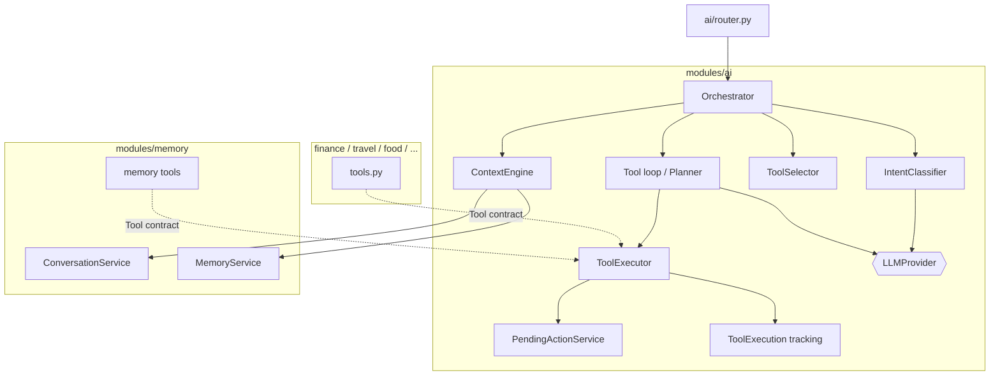

# Kiến trúc đích của AI Personal Assistant

> Trạng thái: **Đề xuất** (M1, 2026-11-20). Chưa có phần nào trong tài liệu này được triển khai, trừ khi ghi rõ "Đã có".
>
> Kiến trúc đang chạy: [../architecture/ai-architecture.md](../architecture/ai-architecture.md). Hiện trạng và vấn đề: [audit.md](audit.md).

## 1. Nguyên tắc nâng cấp

1. **Nâng cấp, không viết lại.** Orchestrator, Tool contract, ToolExecutor, Pending actions và provider adapter đã đúng hướng. Mỗi milestone mở rộng một thành phần và giữ test hiện có đạt.
2. **Giữ các quy tắc tuyệt đối của CLAUDE.md:** LLM chỉ đề xuất; Backend validate và thực thi; Tool ghi luôn qua xác nhận; LLM không tính tiền; không SQL do LLM tạo.
3. **Không thêm framework AI** (ADR-0005). Context, memory, planning được tự xây ở mức vừa đủ.
4. **Không thêm dependency hoặc module nghiệp vụ mới** khi chưa được người dùng phê duyệt (xem [roadmap.md](roadmap.md) mục "Quyết định cần phê duyệt").
5. **Mọi thứ đo được.** Mỗi bước mới ghi log có cấu trúc và có test hành vi bằng `MockLLMProvider`.

## 2. Thành phần đích



| Thành phần | Trạng thái | Trách nhiệm |
| --- | --- | --- |
| `Orchestrator` | Đã có | Điều phối một lượt. Sẽ ủy quyền dần cho các thành phần bên dưới |
| `ContextEngine` | Đề xuất (M2) | Chọn lịch sử, Memory, ngữ cảnh ứng dụng theo ngân sách ký tự; rút gọn kết quả Tool cũ |
| `IntentClassifier` | Đã có, sẽ sửa (M2, M4) | Nhận tin nhắn + vài lượt gần nhất; trả một hoặc vài domain |
| `ToolSelector` | Đề xuất (M4) | Từ domain → danh sách Tool, giới hạn số Tool gửi cho model |
| Tool loop | Đã có | Gọi model, thực thi Tool, lặp trong giới hạn |
| Planner | Đề xuất (M5) | Kế hoạch nhiều bước có trạng thái; chỉ sau khi có nơi lưu kế hoạch |
| `ToolExecutor` | Đã có, sẽ mở rộng (M4) | Thêm timeout riêng, retry cho Tool đọc idempotent, chạy song song Tool đọc |
| Tool execution tracking | Đề xuất (M4) | Bảng `ai_tool_executions` |
| Memory tools | Đề xuất (M3) | `memory_search`, `memory_save` (write, cần xác nhận), `memory_forget` (write) |
| `LLMProvider` | Đã có, sẽ mở rộng (M10) | Capability, token usage, streaming |

## 3. Luồng một lượt chat sau nâng cấp

```text
User message (+ app context tùy chọn)
  → Lưu tin nhắn người dùng                         [đã có]
  → ContextEngine: lịch sử theo ngân sách,          [M2]
      Memory liên quan, ngữ cảnh ứng dụng
  → Intent (có lịch sử ngắn) → domain(s)            [M2, M4]
  → ToolSelector → tập Tool được phép               [M4]
  → Tool loop:
      model → tool_calls
      → validate input → kiểm tra quyền Tool        [đã có / M11]
      → Tool đọc: thực thi (song song nếu an toàn)  [M4]
      → Tool ghi: preview → đề xuất → chờ xác nhận  [đã có]
      → ghi ToolExecution                           [M4]
      → kết quả (đánh dấu là dữ liệu) → model       [M11]
  → Trả lời → lưu → log lượt                        [đã có]
```

## 4. Memory Engine (M3)

Một bảng `memories` dùng chung, mở rộng cột thay vì tạo bốn hệ thống:

| Cột mới (đề xuất) | Mục đích |
| --- | --- |
| `kind` | `long_term`, `episodic`, `semantic` (short-term là ngữ cảnh hội thoại, không lưu bảng) |
| `status` | `active`, `archived` |
| `confidence` | Chỉ có với `ai_inferred` |
| `expires_at` | Memory có thời hạn |
| `last_used_at` | Phục vụ xếp hạng và dọn dẹp |

Vòng đời: Tool `memory_save` (write) → `preview()` báo nội dung và Memory trùng gần nhất → người dùng xác nhận → service chuẩn hóa, chống trùng (so khớp nội dung đã chuẩn hóa), lưu với `source=user_confirmed`. AI không tự lưu Memory mà không có xác nhận (CLAUDE.md mục 7.2).

Migration chỉ thêm cột có giá trị mặc định; không mất dữ liệu.

## 5. Tool system (M4)

`ToolSpec` thêm trường có mặc định, Tool hiện có không phải sửa:

```python
category: ToolCategory = ToolCategory.INFORMATION   # information | management | analysis | workflow | external
timeout_seconds: float | None = None                # None: dùng AI_TOOL_TIMEOUT_SECONDS
idempotent: bool = True                             # chỉ Tool đọc idempotent mới được retry/song song
max_retries: int = 0
```

Bảng `ai_tool_executions` (đề xuất): `id`, `user_id`, `conversation_id`, `message_id`, `tool_name`, `status`, `input` (đã `redact()`), `error_code`, `started_at`, `finished_at`, `duration_ms`, `retry_count`, `pending_action_id`.

Xác nhận đề xuất chuyển sang cập nhật có điều kiện để chặn thực thi hai lần (audit S2).

## 6. Ranh giới module

Không đổi so với CLAUDE.md mục 23.2:

- `ai` → `memory`, `users` (qua `public.py`). `ai` không import module nghiệp vụ.
- Memory tools nằm trong `modules/memory/tools.py`, đăng ký tại `bootstrap.py` như Tool nghiệp vụ. Hướng phụ thuộc `ai → memory` giữ nguyên; `memory` không import `ai` (Tool contract nằm ở `app/shared/tools.py`).
- Module mới (`tasks`, `documents`) chỉ được tạo sau khi được phê duyệt.

## 7. Những gì cố ý không làm

- Không multi-agent (CLAUDE.md mục 6.1).
- Không để model tự chọn bất kỳ Tool nào trong toàn bộ registry; luôn lọc theo domain.
- Không cho custom instruction của người dùng ghi đè quy tắc an toàn: quy tắc an toàn luôn đứng sau và được thực thi bằng code, không chỉ bằng prompt.
- Không tự động chuyển sang provider đám mây khi Ollama lỗi.
