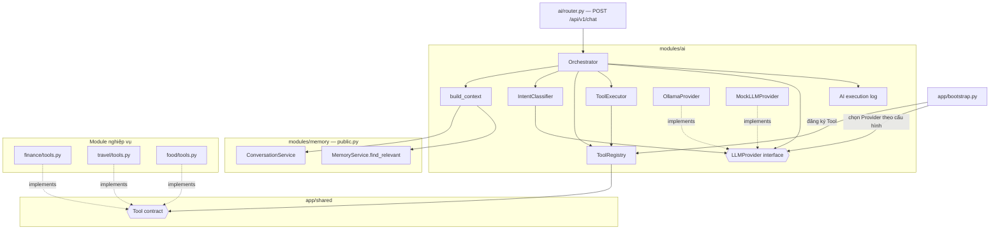
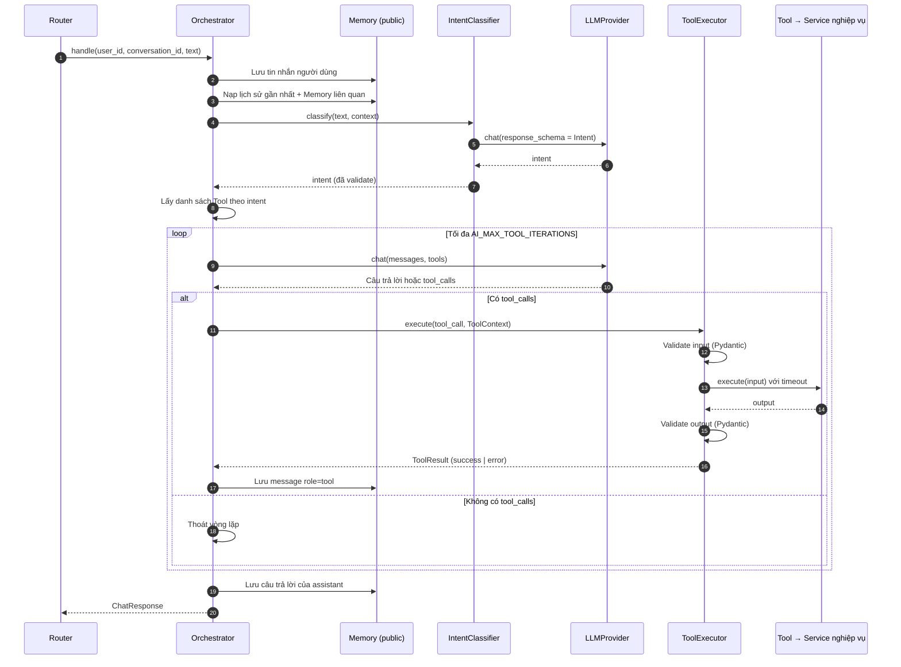
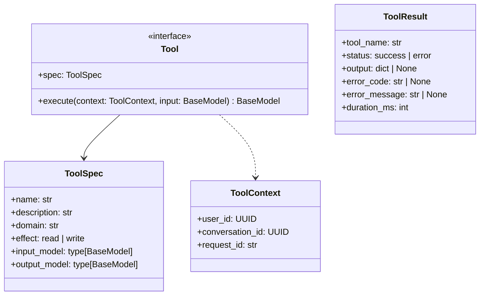
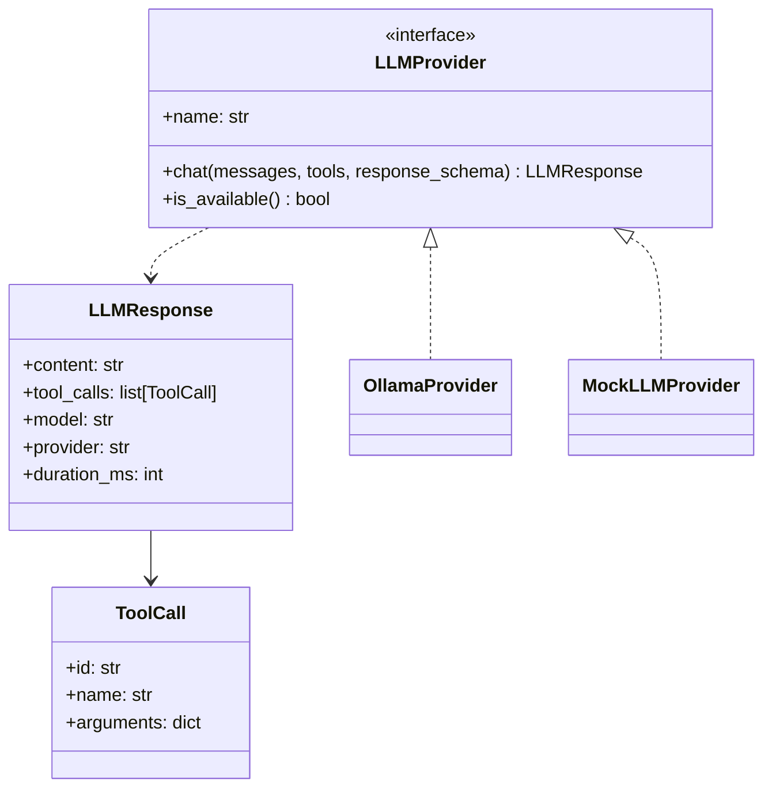

# Kiến trúc AI

> Trạng thái: **Đã phê duyệt và đã triển khai** (Phase 1–6). Tài liệu mô tả code hiện tại.

## 1. Nguyên tắc

1. **Single Agent, Multiple Tools.** Một Orchestrator, không có Multi-Agent.
2. **LLM đề xuất, Backend thực thi.** LLM chỉ chọn Tool và tạo tham số. Backend validate, kiểm tra quyền, thực hiện nghiệp vụ và tính toán.
3. **LLM không truy cập database.** Không có Tool nào nhận SQL. Tool gọi service của module nghiệp vụ.
4. **Không tin tham số do LLM tạo.** Mọi tham số qua Pydantic validation trước khi thực thi.
5. **AI Core không phụ thuộc module nghiệp vụ.** AI Core chỉ biết Tool contract.
6. **Không phụ thuộc Ollama.** Backend khởi động và chạy test khi Ollama không hoạt động.
7. **Không dùng framework AI.** Vòng lặp Tool calling được tự xây; đủ nhỏ để kiểm soát hoàn toàn validation và log.

## 2. Thành phần



| Thành phần | Trách nhiệm |
| --- | --- |
| `Orchestrator` | Điều phối một lượt chat từ đầu đến cuối |
| `build_context` (`context.py`) | Nhận lịch sử hội thoại và Memory liên quan, dựng danh sách message cho LLM |
| `IntentClassifier` | Xác định ý định của tin nhắn, dùng để thu hẹp tập Tool |
| `ToolRegistry` | Lưu Tool đã đăng ký; tra cứu theo tên và theo intent |
| `ToolExecutor` | Validate input, thực thi có timeout, validate output, chuẩn hóa lỗi |
| `LLMProvider` | Interface gọi model |
| `OllamaProvider` | Adapter gọi Ollama qua HTTP |
| `MockLLMProvider` | Provider giả có kịch bản phản hồi định trước, dùng cho test |

## 3. Cấu trúc thư mục

```text
app/shared/tools.py          # Tool contract: Tool, ToolSpec, ToolContext, ToolResult

app/modules/ai/
├── public.py
├── router.py                # POST /api/v1/chat
├── schemas.py               # ChatRequest, ChatResponse
├── dependencies.py
├── exceptions.py            # Lỗi riêng của AI Core
├── orchestrator.py
├── context.py               # build_context: dựng danh sách message cho LLM
├── intent.py                # IntentClassifier
├── prompts.py               # System prompt, prompt phân loại
├── execution_log.py         # Ghi log lượt xử lý AI, che dữ liệu nhạy cảm
├── runtime.py               # AIRuntime: các thành phần sống suốt vòng đời ứng dụng
├── tools/
│   ├── registry.py
│   └── executor.py
└── providers/
    ├── base.py              # LLMProvider, LLMMessage, LLMResponse, ToolCall
    ├── ollama.py
    ├── mock.py
    └── factory.py           # Chọn provider theo Settings
```

## 4. Luồng xử lý một lượt chat

Luồng tuân theo CLAUDE.md mục 6.1.



Ghi chú:

- Bước 1–2: tin nhắn người dùng được lưu trước khi gọi LLM. Lỗi LLM không làm mất tin nhắn.
- Kết quả Tool (kể cả lỗi) được đưa lại cho LLM dưới dạng message `role=tool`. LLM có thể sửa tham số và thử lại trong giới hạn vòng lặp.
- Số liệu trong câu trả lời phải lấy từ output của Tool. System prompt cấm LLM tự tính toán số liệu tài chính.

## 5. Intent Classification

- Tập intent gồm các domain do Tool đăng ký (ví dụ `finance`, `travel`, `food`, `memory`), cùng với `general` và `unknown`.
- `IntentClassifier` gọi LLM với yêu cầu trả JSON theo schema cố định. Kết quả được validate bằng Pydantic.
- Khi chưa có Tool nào được đăng ký, bộ phân loại trả `general` ngay và không gọi LLM.
- Kết quả không hợp lệ (không phải JSON, intent ngoài danh sách): dùng `general` và ghi log WARNING. Trả lời không dùng Tool không thể thay đổi dữ liệu, nên đây là phương án dự phòng an toàn.
- LLM lỗi (không kết nối được, quá thời gian): exception được chuyển tiếp; request trả lỗi 503/504.
- `general`: trả lời không dùng Tool. `unknown`: trợ lý hỏi lại người dùng để làm rõ.

Lý do giữ bước riêng:

- CLAUDE.md mục 6.1 và 6.4 yêu cầu bước này và yêu cầu ghi log intent.
- Model cục bộ chọn Tool chính xác hơn khi danh sách Tool ngắn.

Đánh đổi: thêm một lần gọi LLM cho mỗi lượt chat. `IntentClassifier` là một interface; có thể thay bằng bộ phân loại theo luật hoặc bỏ bước gọi LLM mà không sửa Orchestrator.

## 6. Tool contract

Tool contract nằm tại `app/shared/tools.py` để cả AI Core và module nghiệp vụ cùng phụ thuộc vào nó, không phụ thuộc lẫn nhau.



Quy tắc:

- `name` duy nhất, dạng `domain_action` (ví dụ `finance_create_transaction`). Registry từ chối tên trùng khi khởi động.
- JSON Schema gửi cho LLM được sinh từ `input_model`. Không viết schema bằng tay.
- `user_id` luôn lấy từ `ToolContext`. `user_id` không bao giờ là tham số do LLM cung cấp.
- Tool không chứa quy tắc nghiệp vụ. Tool chuyển input thành lời gọi service của chính module đó.
- Tool nhận dependency qua constructor tại `app/bootstrap.py`. Mỗi lần thực thi mở một session và transaction riêng.
- `effect=write` đánh dấu Tool làm thay đổi dữ liệu. Tool ghi phải cài `preview()` trả câu mô tả thay đổi.

### Xác nhận thay đổi

Model chỉ được **đề xuất** thay đổi dữ liệu:

1. `ToolExecutor` kiểm tra tham số của Tool ghi, gọi `preview()` (có thể ném `AppError` khi thấy trước là sẽ thất bại), rồi trả `ToolResult` với `status=pending`. `execute()` chưa chạy.
2. Orchestrator lưu đề xuất vào `ai_pending_actions` (`PendingActionService.propose`) và báo cho model: `awaiting_user_confirmation`, chưa có gì được lưu.
3. `ChatResponse.pending_actions` đưa đề xuất ra giao diện; giao diện hiện thẻ "Xác nhận / Hủy".
4. `POST /chat/actions/{id}/confirm`: `ToolExecutor.execute_confirmed` kiểm tra lại tham số rồi gọi `execute()`. Lỗi nghiệp vụ được ghi thành `status=failed`, không ném ra ngoài.
5. Kết quả được thêm vào hội thoại dưới dạng message `system`, để lượt sau model biết chuyện gì đã xảy ra.

Mỗi đề xuất chỉ được xác nhận hoặc hủy một lần (409 nếu lặp lại).

Tool nghiệp vụ đã đăng ký tại `build_tool_registry()` trong `app/bootstrap.py`: 4 Tool `finance`, 5 Tool `travel`, 2 Tool `food` (danh sách đầy đủ: `docs/ai-upgrade/audit.md` mục 1.3). Tool mẫu cho test nằm trong `tests/ai_support.py`.

## 7. Tool Execution

`ToolExecutor.execute` thực hiện tuần tự:

1. Tra Tool theo tên. Tool không tồn tại hoặc không thuộc tập Tool của intent hiện tại → `ToolResult` lỗi `tool_not_found`.
2. Validate tham số bằng `input_model`. Sai → `invalid_tool_input` kèm danh sách trường lỗi.
3. Gọi `tool.execute` trong `asyncio.timeout(AI_TOOL_TIMEOUT_SECONDS)`. Quá hạn → `tool_timeout`.
4. `AppError` từ service → `ToolResult` lỗi với `code` của exception.
5. Exception chưa lường trước → ghi log ERROR kèm stack trace, trả `tool_execution_failed`. Thông điệp nội bộ không được gửi cho LLM.
6. Validate kết quả bằng `output_model`. Sai → `invalid_tool_output` (lỗi lập trình; ghi log ERROR).
7. Ghi execution log và trả `ToolResult`.

`ToolExecutor` không ném exception ra Orchestrator cho lỗi của Tool. Mọi lỗi được biểu diễn bằng `ToolResult`.

## 8. LLM Provider



- Kiểu dữ liệu `LLMMessage`, `LLMResponse`, `ToolCall` trung lập với nhà cung cấp. Mỗi adapter tự chuyển đổi sang định dạng của nhà cung cấp.
- `OllamaProvider` gọi API chat của Ollama bằng `httpx.AsyncClient` dùng chung. Model, temperature, timeout lấy từ `Settings`.
- `OllamaProvider` chuyển lỗi thành exception của hệ thống:

| Tình huống | Exception |
| --- | --- |
| Không kết nối được | `ExternalServiceUnavailableError` |
| Quá thời gian | `ExternalServiceTimeoutError` |
| HTTP lỗi hoặc JSON sai cấu trúc | `ExternalServiceError` |

- Provider được tạo một lần trong `lifespan`. Việc tạo provider **không** kết nối tới Ollama. Kết nối chỉ xảy ra khi có lời gọi `chat`.
- `MockLLMProvider` nhận danh sách phản hồi định trước và ghi lại các lời gọi đã nhận. Được chọn khi `LLM_PROVIDER=mock`.
- Thêm nhà cung cấp mới: viết một adapter và thêm một nhánh trong `providers/factory.py`.

Streaming chưa nằm trong interface. Khi cần, bổ sung phương thức `stream_chat` mà không đổi `chat`.

`OllamaProvider` dùng `POST /api/chat` (`stream: false`, `tools`, `format`) và `GET /api/version`, đã đối chiếu với tài liệu API chính thức của Ollama ngày 2026-11-14. Ollama không cấp ID cho tool call; adapter tự sinh ID.

`OLLAMA_MODEL` rỗng nghĩa là chưa cấu hình: ứng dụng vẫn khởi động, endpoint chat trả lỗi `llm_not_configured` (503).

**Chưa kiểm thử với Ollama thật.** Adapter mới được kiểm thử bằng HTTP transport giả.

## 9. Conversation Context và Memory Retrieval

- Hội thoại và tin nhắn thuộc module `memory` (Conversation Memory). AI Core chỉ dùng `memory/public.py`.
- Context gồm: system prompt, Memory liên quan, N tin nhắn gần nhất của **đúng** hội thoại hiện tại, tin nhắn mới.
- N được cấu hình. Giới hạn theo số token sẽ được bổ sung khi có số đo thực tế.
- Memory Retrieval trong MVP (`MemoryService.find_relevant`): nạp 200 Memory mới nhất của người dùng, chấm điểm theo số từ khóa trùng với tin nhắn, bỏ Memory không trùng từ nào. Không dùng vector database.
- Memory được chèn vào context kèm nguồn gốc (`user_confirmed` hoặc `ai_inferred`).
- AI không tự động lưu Memory. **Hiện chưa có đường ghi Memory nào** (không API, không Tool), nên bảng `memories` luôn rỗng khi chạy thật. Đường ghi qua Tool có xác nhận được lên kế hoạch ở M3 (`docs/ai-upgrade/roadmap.md`).

## 10. Xử lý khi AI hoạt động sai

| Tình huống | Hành vi |
| --- | --- |
| LLM không phản hồi hoặc Ollama không chạy | Router trả lỗi 503/504 theo error envelope. Tin nhắn người dùng vẫn được lưu |
| LLM chọn Tool không tồn tại | `ToolResult` lỗi gửi lại cho LLM; tính vào giới hạn vòng lặp |
| LLM tạo tham số sai | Lỗi validation gửi lại cho LLM để sửa; tính vào giới hạn vòng lặp |
| Tool thất bại | `ToolResult` lỗi gửi lại cho LLM; LLM giải thích cho người dùng |
| Vượt `AI_MAX_TOOL_ITERATIONS` | Dừng vòng lặp; trả lời rằng yêu cầu chưa hoàn thành; ghi log WARNING |
| Intent không xác định | Hỏi lại người dùng; không gọi Tool |
| LLM trả nội dung rỗng | Trả thông điệp dự phòng; ghi log WARNING |

## 11. AI execution log

Mỗi lượt xử lý ghi các trường theo CLAUDE.md mục 6.4:

| Trường | Nội dung |
| --- | --- |
| `request_id` | Liên kết với log của HTTP request |
| `conversation_id`, `message_id` | Định danh hội thoại và tin nhắn |
| `intent` | Intent được nhận diện |
| `provider`, `model` | LLM Provider và model |
| `tool_name` | Tool được chọn |
| `tool_input` | Tham số đã lọc thông tin nhạy cảm |
| `status` | `success` hoặc `error` |
| `error_code` | Mã lỗi khi thất bại |
| `duration_ms` | Thời gian của từng lần gọi LLM và từng Tool |
| `iterations` | Số vòng Tool đã chạy |

Hai nơi lưu:

1. **Log có cấu trúc** qua logger `app.modules.ai`. Dùng để debug.
2. **Bảng `messages`.** Lời gọi Tool và kết quả Tool được lưu thành message `role=tool`. Chúng vừa là ngữ cảnh hội thoại, vừa là lịch sử thực thi. Không cần bảng riêng.

Lọc dữ liệu nhạy cảm: `execution_log.py` che giá trị của các trường có tên khớp danh sách cấm (ví dụ `password`, `token`, `api_key`) trước khi ghi. Nội dung tin nhắn đầy đủ chỉ được ghi ở mức DEBUG.

## 12. Kiểm thử

Mọi test AI dùng `MockLLMProvider`. Không test nào cần Ollama.

| Đối tượng | Nội dung kiểm thử |
| --- | --- |
| `ToolRegistry` | Đăng ký, tên trùng, tra cứu theo intent |
| `ToolExecutor` | Input sai, Tool không tồn tại, timeout, lỗi nghiệp vụ, output sai, luồng thành công |
| `IntentClassifier` | Kết quả hợp lệ, JSON sai, provider lỗi |
| `Orchestrator` | Không dùng Tool; một Tool; nhiều vòng; chọn sai Tool; tham số sai; vượt giới hạn vòng lặp; provider lỗi |
| `OllamaProvider` | Chuyển đổi request/response; timeout; mất kết nối; JSON sai — dùng `httpx.MockTransport` |
| Context | Không trộn tin nhắn giữa các hội thoại; giới hạn N tin nhắn |

Test đánh giá hành vi (Tool nào được gọi, tham số nào, trạng thái nào), không so sánh nguyên văn câu trả lời.

Kiểm thử với Ollama thật là kiểm thử thủ công, tùy chọn, được đánh dấu riêng và không chạy mặc định.
