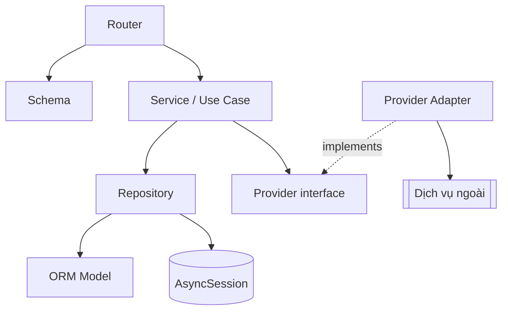
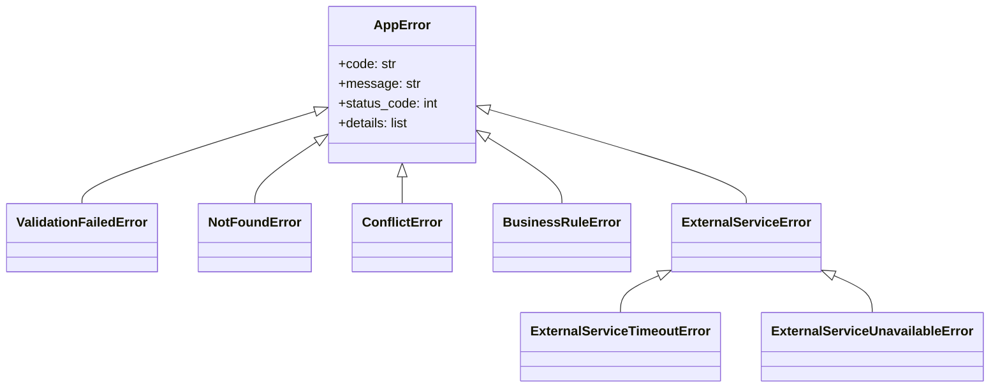
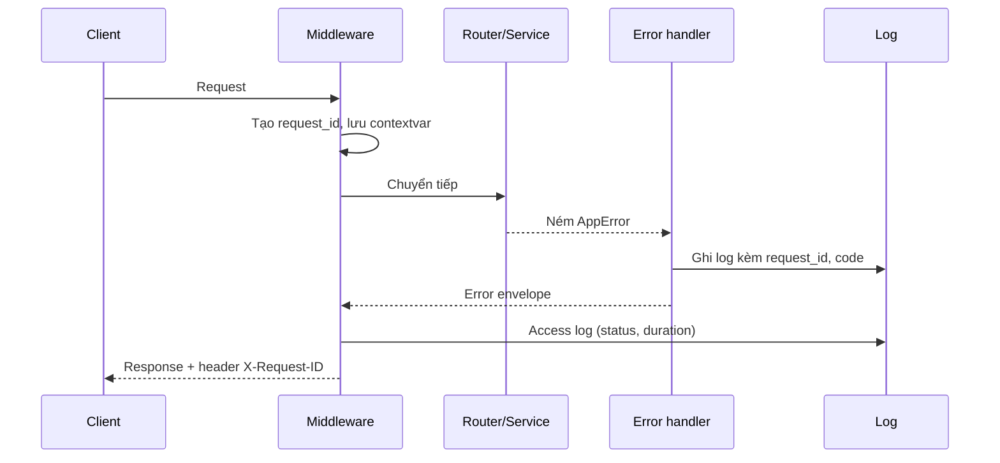

# Kiến trúc Backend

> Trạng thái: **Đã phê duyệt.** Phase 2 và Phase 3 đã triển khai; phần AI (Phase 4) chưa triển khai.

## 1. Công nghệ

| Thành phần | Lựa chọn | Ghi chú |
|---|---|---|
| Ngôn ngữ | Python 3.14 | Phiên bản đang cài trên máy phát triển |
| Web framework | FastAPI | |
| Validation | Pydantic v2 | |
| Cấu hình | `pydantic-settings` | Đọc `.env`, validate kiểu dữ liệu |
| ORM | SQLAlchemy 2.0 (async) | Cú pháp `Mapped[...]` có type hint |
| Driver | `aiosqlite` | Chuyển sang `asyncpg` khi dùng PostgreSQL |
| Migration | Alembic | |
| HTTP client | `httpx` (async) | Gọi Ollama và dịch vụ ngoài; cũng dùng cho API test |
| Test | Pytest, `pytest-asyncio` | |
| Chất lượng | Ruff, mypy | Dev dependency |
| Quản lý dependency | `uv` + `pyproject.toml` + `uv.lock` | |

## 2. Cấu trúc thư mục

```text
backend/
├── pyproject.toml
├── uv.lock
├── .env.example
├── alembic.ini
├── alembic/
│   ├── env.py
│   └── versions/
├── app/
│   ├── main.py                 # create_app(): lắp ráp ứng dụng
│   ├── bootstrap.py            # Composition root: đăng ký Tool, chọn Provider
│   ├── api/
│   │   └── v1.py               # Gom router của các module dưới /api/v1
│   ├── core/                   # Hạ tầng xuyên suốt, không chứa nghiệp vụ
│   │   ├── config.py           # Settings
│   │   ├── logging.py          # Cấu hình log, JSON formatter
│   │   ├── request_context.py  # request_id qua contextvars
│   │   ├── middleware.py       # Request ID + access log
│   │   ├── exceptions.py       # Phân cấp AppError, ErrorDetail
│   │   └── error_handlers.py   # ErrorResponse; chuyển exception thành error envelope
│   ├── shared/                 # Shared kernel (tạo ở Phase 4)
│   │   └── tools.py            # Tool contract (xem ai-architecture.md)
│   ├── infrastructure/
│   │   └── database/
│   │       ├── base.py         # DeclarativeBase, naming convention, UtcDateTime, mixin
│   │       ├── session.py      # Engine, session factory, dependency get_session
│   │       └── models.py       # Import mọi model để Alembic nhận diện metadata
│   └── modules/
│       ├── health/
│       ├── users/
│       ├── ai/
│       ├── memory/
│       ├── finance/
│       ├── travel/
│       ├── food/
│       └── dashboard/
└── tests/
    ├── conftest.py
    ├── architecture/           # Kiểm tra ranh giới module
    ├── core/
    ├── infrastructure/
    └── modules/<module>/
```

Thư mục module chỉ được tạo khi module đó có code thực. Phase 2 chỉ tạo `health`. Phase 3 và 4 tạo `users`, `memory`, `ai`. Các module `finance`, `travel`, `food`, `dashboard` được tạo khi có yêu cầu triển khai.

## 3. Cấu trúc bên trong một module

```text
modules/finance/
├── __init__.py
├── public.py          # Public interface DUY NHẤT cho module khác
├── router.py          # Endpoint FastAPI
├── schemas.py         # Pydantic request/response
├── service.py         # Use case, quy tắc nghiệp vụ
├── repository.py      # Truy vấn SQLAlchemy
├── models.py          # ORM model
├── dependencies.py    # Lắp ráp service cho FastAPI Depends
├── exceptions.py      # Lỗi nghiệp vụ riêng của module
└── tools.py           # Tool cho AI (nếu module cung cấp Tool)
```

Quy ước:

- Bắt đầu bằng file phẳng. Khi một file vượt quá khoảng 300 dòng hoặc chứa nhiều nhóm nghiệp vụ, tách thành package (ví dụ `service/transactions.py`, `service/budgets.py`).
- Không tạo file rỗng. File chỉ xuất hiện khi có nội dung.
- Module `ai` có thêm thư mục con; xem [ai-architecture.md](ai-architecture.md).

## 4. Phân tầng và hướng phụ thuộc



| Tầng | Được phép | Không được phép |
|---|---|---|
| Router | Khai báo endpoint, nhận schema, gọi service, trả response schema | Truy vấn DB, chứa quy tắc nghiệp vụ, bắt exception để tự tạo response lỗi |
| Schema | Validate, serialize | Truy cập DB, gọi service |
| Service | Quy tắc nghiệp vụ, điều phối repository và provider, quản lý transaction | Import `fastapi`, đọc `Request`, trả `Response` |
| Repository | Truy vấn và ghi dữ liệu | Quy tắc nghiệp vụ, `commit()` |
| Model | Cấu trúc bảng, quan hệ trong cùng module | Luồng nghiệp vụ |
| Adapter | Gọi dịch vụ ngoài, chuyển đổi dữ liệu, chuyển lỗi mạng thành `ExternalServiceError` | Quy tắc nghiệp vụ |

Service là class Python thuần, nhận dependency qua constructor. Service kiểm thử được mà không cần khởi động FastAPI.

## 5. Dependency Injection

Dùng cơ chế `Depends` của FastAPI. Không dùng DI container.

```text
Router
  └─ Depends(get_transaction_service)        # modules/finance/dependencies.py
        ├─ Depends(get_session)              # infrastructure/database/session.py
        └─ Depends(get_current_user)         # modules/users/public.py
```

- Mỗi module có `dependencies.py` chứa các hàm factory lắp ráp service.
- Test thay dependency bằng `app.dependency_overrides` hoặc khởi tạo service trực tiếp với repository/provider giả.
- Đối tượng sống suốt vòng đời ứng dụng (engine, HTTP client, LLM Provider, Tool Registry) được tạo trong `lifespan` và lưu ở `app.state`.

## 6. Giao tiếp giữa các module

1. **Gọi trực tiếp qua `public.py`.** Module A import service hoặc DTO được module B công bố trong `modules/b/public.py`. Mọi import khác vào nội bộ module B đều bị cấm.
2. **Tool contract.** Module nghiệp vụ công bố khả năng cho AI bằng cách định nghĩa Tool theo contract trong `app/shared/tools.py`. `app/bootstrap.py` thu thập và đăng ký Tool. AI Core không biết module nào tồn tại.

Quy tắc dữ liệu:

- Module không truy vấn bảng của module khác.
- Không khai báo `relationship()` giữa model của hai module khác nhau. Khóa ngoại liên module chỉ là cột ID. Trường hợp duy nhất hiện có là `user_id` trỏ tới `users.id`.
- Dữ liệu trao đổi giữa module là Pydantic DTO hoặc kiểu nguyên thủy, không phải ORM model.

Không dùng event bus. Nếu sau này cần phản ứng bất đồng bộ giữa module, quyết định sẽ được ghi bằng ADR.

## 7. Quản lý transaction

- Mỗi request nhận một `AsyncSession` qua `get_session`.
- **Service sở hữu ranh giới transaction.** Service gọi `commit()` khi use case hoàn tất. Repository chỉ `add`, `flush`, `execute`.
- `get_session` gọi `rollback()` khi có exception và luôn đóng session.
- Trong luồng Chat, mỗi lần thực thi Tool là một transaction độc lập. Tool thất bại không hủy tin nhắn người dùng đã lưu.

## 8. Cấu hình và môi trường

Một class `Settings` duy nhất trong `core/config.py`. Truy cập qua hàm `get_settings()` có cache.

| Biến | Ý nghĩa | Mặc định Development |
|---|---|---|
| `APP_ENV` | `development` / `testing` / `production` | `development` |
| `DATABASE_URL` | Chuỗi kết nối SQLAlchemy | `sqlite+aiosqlite:///./data/app.db` |
| `CORS_ALLOWED_ORIGINS` | Danh sách origin, phân tách bằng dấu phẩy | `http://localhost:5173` |
| `LOG_LEVEL` | Mức log | `DEBUG` |
| `LOG_FORMAT` | `console` / `json` | `console` |

Các biến dưới đây thuộc hạ tầng AI và được thêm vào `Settings` ở Phase 4:

| Biến | Ý nghĩa | Mặc định Development |
|---|---|---|
| `LLM_PROVIDER` | `ollama` / `mock` | `ollama` |
| `OLLAMA_BASE_URL` | Địa chỉ Ollama | `http://localhost:11434` |
| `OLLAMA_MODEL` | Tên model | Chọn ở Phase 4 |
| `LLM_TEMPERATURE` | Temperature | `0.2` |
| `LLM_TIMEOUT_SECONDS` | Timeout mỗi lần gọi LLM | `60` |
| `AI_MAX_TOOL_ITERATIONS` | Giới hạn vòng gọi Tool mỗi lượt | `5` |
| `AI_TOOL_TIMEOUT_SECONDS` | Timeout mỗi lần thực thi Tool | `15` |

Quy tắc:

- Không có giá trị môi trường nào nằm rải rác trong code. Mọi nơi đọc từ `Settings`.
- `production` yêu cầu `CORS_ALLOWED_ORIGINS` tường minh (không rỗng, không chứa `*`); `Settings` từ chối khởi động nếu vi phạm.
- Địa chỉ và cổng lắng nghe là tham số của uvicorn (`--host`, `--port`), mặc định `127.0.0.1:8000`.
- Môi trường `testing` do `tests/conftest.py` thiết lập: mỗi test có một database SQLite riêng, tạo bằng migration thật. Test không đọc file `.env` của người phát triển.
- File database nằm trong `backend/data/`, thư mục này thuộc `.gitignore`.

## 9. API

- Tiền tố phiên bản: `/api/v1`. `app/api/v1.py` gom router của các module.
- Endpoint đặt theo tài nguyên, đúng danh sách trong CLAUDE.md mục 9.
- Tài liệu OpenAPI do FastAPI sinh tự động tại `/docs`; tắt ở `production`.

### 9.1. Response thành công

- Tài nguyên đơn: trả trực tiếp object của response schema.
- Danh sách có khả năng tăng trưởng: dùng `Page[T]`.

```json
{
  "items": [],
  "total": 0,
  "limit": 20,
  "offset": 0
}
```

### 9.2. Response lỗi

Mọi lỗi trả cùng một cấu trúc:

```json
{
  "error": {
    "code": "transaction_not_found",
    "message": "Không tìm thấy giao dịch.",
    "details": [],
    "request_id": "0c1f7e0e6f0b4d3f9a1f3b6f2c5d7e9a"
  }
}
```

- `code`: định danh ổn định, dạng `snake_case`, Frontend dùng để phân nhánh xử lý.
- `message`: thông điệp an toàn cho người dùng.
- `details`: danh sách lỗi theo trường, dùng cho lỗi validation.
- `request_id`: dùng để tìm log tương ứng.

### 9.3. Health check

`GET /api/v1/health` trả trạng thái ứng dụng và kết quả kiểm tra kết nối database. Database lỗi: HTTP 503 với `status = degraded`.

Từ Phase 4, trạng thái Ollama được báo ở trường riêng và **không** làm health check thất bại.

## 10. Xử lý lỗi



| Loại lỗi | Lớp | HTTP | Mức log |
|---|---|---|---|
| Dữ liệu request không hợp lệ | `RequestValidationError` của FastAPI, `ValidationFailedError` | 422 | INFO |
| Không tìm thấy tài nguyên | `NotFoundError` | 404 | INFO |
| Xung đột trạng thái | `ConflictError` | 409 | INFO |
| Vi phạm quy tắc nghiệp vụ | `BusinessRuleError` | 422 | WARNING |
| Dịch vụ ngoài lỗi | `ExternalServiceError` | 502 | ERROR |
| Dịch vụ ngoài quá thời gian | `ExternalServiceTimeoutError` | 504 | ERROR |
| Dịch vụ ngoài không sẵn sàng | `ExternalServiceUnavailableError` | 503 | ERROR |
| Lỗi chưa lường trước | `Exception` | 500 | ERROR kèm stack trace |

Quy tắc:

- Module định nghĩa lỗi riêng bằng cách kế thừa các lớp trên, ví dụ `TransactionNotFoundError(NotFoundError)`.
- Service ném exception. Router không bắt exception. `core/error_handlers.py` chuyển `AppError`, lỗi validation request và lỗi HTTP của framework thành HTTP response.
- Exception chưa lường trước được `RequestContextMiddleware` bắt, để log vẫn còn `request_id` (ADR-0009). Lỗi 500 trả thông điệp chung. Stack trace chỉ nằm trong log.
- Adapter bắt lỗi của thư viện (ví dụ `httpx.TimeoutException`) và ném lại dưới dạng `ExternalServiceError`, giữ nguyên nguyên nhân bằng `raise ... from`.
- Không dùng `except Exception: pass`.

## 11. Logging

- Dùng thư viện chuẩn `logging`. Mỗi file lấy logger bằng `logging.getLogger(__name__)`; tên logger thể hiện module và tầng (`app.modules.finance.service`).
- `LOG_FORMAT=console`: một dòng dễ đọc cho Development. `LOG_FORMAT=json`: mỗi dòng một object JSON.
- Middleware tạo `request_id` cho mỗi request (hoặc nhận từ header `X-Request-ID`), lưu vào `contextvars`, trả lại trong header response. Một logging filter gắn `request_id` vào mọi bản ghi log.
- Trường log chuẩn: `timestamp`, `level`, `logger`, `message`, `request_id`, cùng các trường ngữ cảnh truyền qua `extra`.
- Access log: method, path, status, thời gian xử lý (ms).
- Không ghi secret, nội dung `.env`, hoặc dữ liệu cá nhân nhạy cảm. Tham số Tool được lọc trước khi ghi (xem [ai-architecture.md](ai-architecture.md) mục 9).



## 12. Bảo mật ở giai đoạn nền tảng

- Backend lắng nghe `127.0.0.1` theo mặc định.
- CORS chỉ cho phép origin khai báo trong cấu hình.
- Chưa có authentication. `get_current_user` trả về người dùng cục bộ mặc định. Khi bổ sung authentication, chỉ cần thay dependency này (ADR-0007).
- Mọi truy vấn đi qua SQLAlchemy với tham số hóa. Không ghép chuỗi SQL.
- `.env` thuộc `.gitignore`. `.env.example` chỉ chứa giá trị mẫu.
