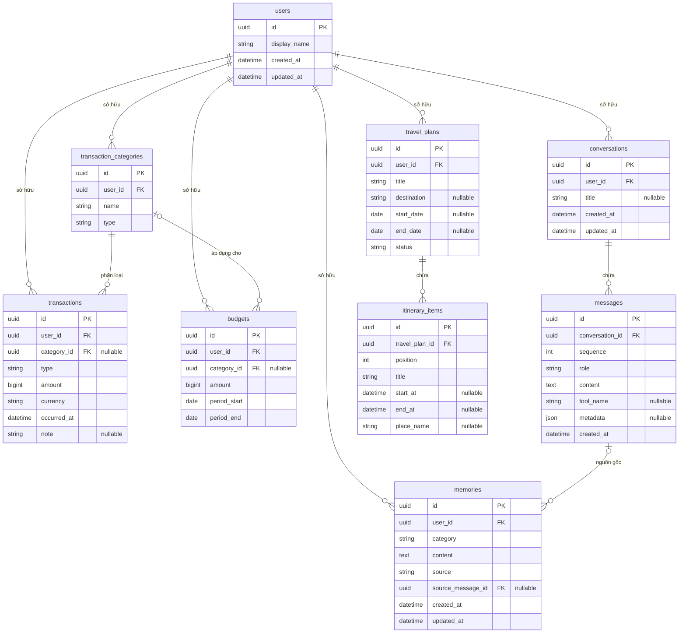

# Kiến trúc Database

> Trạng thái: **Đã phê duyệt.** Phase 2 và Phase 3 đã triển khai; phần AI (Phase 4) chưa triển khai.

## 1. Công nghệ

| Thành phần | Lựa chọn |
|---|---|
| Database MVP | SQLite (một file trong `backend/data/`) |
| Database tương lai | PostgreSQL |
| ORM | SQLAlchemy 2.0 async |
| Driver | `aiosqlite` (sau này `asyncpg`) |
| Migration | Alembic |

## 2. Quyền sở hữu dữ liệu

- Mỗi bảng thuộc đúng một module. ORM model nằm trong `modules/<module>/models.py`.
- Chỉ repository của module sở hữu được truy vấn bảng đó.
- `infrastructure/database/models.py` import mọi model để Alembic thấy toàn bộ metadata. File này không chứa logic.
- Khóa ngoại liên module chỉ là cột ID, không có `relationship()`. Hiện chỉ có `user_id → users.id`.

| Bảng | Module sở hữu |
|---|---|
| `users` | `users` |
| `conversations`, `messages`, `memories` | `memory` |
| `transaction_categories`, `transactions`, `budgets` | `finance` |
| `travel_plans`, `itinerary_items` | `travel` |

## 3. Quy ước chung

### 3.1. Đặt tên

- Bảng: `snake_case`, số nhiều.
- Cột: `snake_case`. Khóa ngoại: `<thực_thể>_id`.
- Ràng buộc và index đặt tên theo naming convention khai báo trên `MetaData`:

| Loại | Mẫu tên |
|---|---|
| Primary key | `pk_<bảng>` |
| Foreign key | `fk_<bảng>_<cột>_<bảng_tham_chiếu>` |
| Unique | `uq_<bảng>_<cột>` |
| Index | `ix_<bảng>_<cột>` |
| Check | `ck_<bảng>_<tên>` |

Tên ràng buộc tường minh là điều kiện để Alembic sửa bảng trên SQLite và để migration chạy giống nhau trên PostgreSQL.

### 3.2. Khóa chính

- Kiểu `Uuid` của SQLAlchemy. Giá trị sinh ở tầng ứng dụng.
- SQLite lưu dạng `CHAR(32)`; PostgreSQL dùng kiểu `uuid` gốc. Code không đổi.

### 3.3. Thời gian

- Mọi mốc thời gian lưu theo UTC.
- Ứng dụng luôn dùng `datetime` có timezone. SQLite không lưu timezone, nên một kiểu cột dùng chung đảm bảo giá trị đọc ra luôn gắn UTC.
- Mixin `TimestampMixin` cung cấp `created_at` và `updated_at`.
- Ngày không có giờ (ngày đi, ngày về, kỳ ngân sách) dùng kiểu `Date`.

### 3.4. Tiền tệ

- Số tiền lưu bằng `BigInteger`, đơn vị đồng (VND). VND không có đơn vị lẻ.
- Không dùng `Float` cho tiền ở bất kỳ tầng nào.
- Cột `currency` (`CHAR(3)`, mặc định `VND`) được giữ để mở rộng. Nếu sau này hỗ trợ tiền tệ có đơn vị lẻ, số tiền được lưu theo đơn vị nhỏ nhất của tiền tệ đó.
- Mọi phép tổng hợp tiền do Backend thực hiện.

### 3.5. Giá trị liệt kê

- Lưu dạng chuỗi (`VARCHAR`), ánh xạ với `StrEnum` của Python.
- Không dùng kiểu `ENUM` gốc của database. Lý do: SQLite không hỗ trợ; thay đổi tập giá trị trên PostgreSQL phức tạp.
- Tính hợp lệ được kiểm tra ở Pydantic schema và service.

### 3.6. Xóa dữ liệu

- `ON DELETE` được khai báo tường minh cho mọi khóa ngoại. Mặc định là `RESTRICT`.
- `CASCADE` chỉ dùng cho quan hệ thành phần, khi bản ghi con không có ý nghĩa nếu thiếu bản ghi cha: `messages` theo `conversations`, `itinerary_items` theo `travel_plans`.
- Không dùng soft delete ở giai đoạn này.

### 3.7. Dữ liệu bán cấu trúc

- Dùng kiểu `JSON` chung của SQLAlchemy (SQLite lưu dạng text; PostgreSQL có thể chuyển sang `JSONB`).
- Chỉ dùng cho metadata không cần truy vấn. Dữ liệu cần lọc hoặc sắp xếp phải là cột riêng.

## 4. Mô hình dữ liệu

## 5. Nhóm bảng lõi (đề xuất tạo ở Phase 3)

Đây là các bảng mà hạ tầng AI ở Phase 4 cần để hoạt động.

### 5.1. `users`

Trách nhiệm: định danh chủ sở hữu dữ liệu.

- MVP có một người dùng cục bộ mặc định, được tạo bởi migration đầu tiên với ID cố định.
- Chưa có cột xác thực (email, mật khẩu). Các cột này được thêm bằng migration khi triển khai authentication.

### 5.2. `conversations`

Trách nhiệm: một phiên hội thoại.

| Ràng buộc | Chi tiết |
|---|---|
| FK | `user_id → users.id`, `RESTRICT` |
| Index | `(user_id, updated_at)` — liệt kê hội thoại gần nhất |

### 5.3. `messages`

Trách nhiệm: một tin nhắn hoặc một bản ghi thực thi Tool trong hội thoại.

| Ràng buộc | Chi tiết |
|---|---|
| FK | `conversation_id → conversations.id`, `CASCADE` |
| Unique | `(conversation_id, sequence)` — thứ tự xác định trong hội thoại |
| `role` | `user`, `assistant`, `tool`, `system` |
| `tool_name` | Chỉ có giá trị khi `role = tool` |
| `metadata` | Lời gọi Tool, intent, provider, model, thời gian xử lý |

`sequence` được dùng thay cho sắp xếp theo `created_at`, vì nhiều message trong một lượt có thể cùng mốc thời gian. Unique `(conversation_id, sequence)` đồng thời là index cho truy vấn nạp lịch sử.

### 5.4. `memories`

Trách nhiệm: thông tin cá nhân dài hạn.

| Ràng buộc | Chi tiết |
|---|---|
| FK | `user_id → users.id`, `RESTRICT` |
| FK | `source_message_id → messages.id`, `SET NULL` — xóa hội thoại không xóa Memory |
| Index | `(user_id, category)` |
| `category` | `preference`, `habit`, `goal`, `fact` (chốt ở Phase 3) |
| `source` | `user_confirmed`, `ai_inferred` |

`source`, `source_message_id` và `created_at` đáp ứng yêu cầu về nguồn gốc và thời gian tạo của CLAUDE.md mục 7.2.

## 6. Nhóm bảng nghiệp vụ (thiết kế sơ bộ)

Các bảng dưới đây là bản nháp. Cột và ràng buộc chi tiết được thiết kế khi module tương ứng được triển khai. Đề xuất: chưa tạo các bảng này trong migration đầu tiên.

### 6.1. Finance

- `transaction_categories`: danh mục của người dùng. Unique `(user_id, name, type)`.
- `transactions`: `type` gồm `income`, `expense`, `adjustment`. `category_id` dùng `RESTRICT`. Index `(user_id, occurred_at)`. Check `amount > 0` cho thu và chi.
- `budgets`: hạn mức theo kỳ. `category_id` rỗng nghĩa là ngân sách tổng.

Vấn đề cần chốt khi thiết kế Finance: cách biểu diễn dấu của giao dịch `adjustment`; quy tắc khi xóa danh mục đang có giao dịch; định nghĩa kỳ ngân sách.

### 6.2. Travel

- `travel_plans`: `status` gồm các giá trị như `draft`, `planned`, `completed`.
- `itinerary_items`: thuộc một kế hoạch; `position` xác định thứ tự. Tọa độ (nếu có) dùng `Float`, vì đây không phải dữ liệu tiền.

### 6.3. Food Discovery

Chưa có bảng. Dữ liệu địa điểm đến từ dịch vụ bên ngoài. Việc lưu địa điểm yêu thích hoặc cache sẽ được quyết định khi thiết kế module.

## 7. Session và transaction

- Một `AsyncEngine` cho toàn ứng dụng, tạo trong `lifespan`.
- Một `AsyncSession` cho mỗi request, cấp qua dependency `get_session`.
- Service quyết định thời điểm `commit()`. Repository không `commit()`.
- `expire_on_commit=False` để đối tượng dùng được sau khi commit trong ngữ cảnh async.
- Quan hệ được nạp tường minh (`selectinload`, `joinedload`). Lazy loading ngầm không hoạt động với async và bị coi là lỗi. Quy tắc này cũng ngăn truy vấn N+1.

Thiết lập riêng cho SQLite:

- `PRAGMA foreign_keys=ON` trên mỗi kết nối. SQLite không kiểm tra khóa ngoại theo mặc định.
- `PRAGMA journal_mode=WAL` để đọc không bị chặn khi đang ghi.

## 8. Migration

- Mọi thay đổi schema đi qua Alembic. Không sửa database bằng tay. Không dùng `Base.metadata.create_all()` trong code ứng dụng.
- `alembic/env.py` lấy `DATABASE_URL` từ `Settings`, không từ `alembic.ini`.
- Bật `render_as_batch=True`. SQLite không hỗ trợ phần lớn lệnh `ALTER TABLE`; batch mode tạo lại bảng một cách an toàn.
- Quy trình: sửa model → `alembic revision --autogenerate` → **đọc và chỉnh file migration** → chạy `upgrade` → chạy test.
- Mỗi migration có `downgrade()` hoạt động được. Migration làm mất dữ liệu phải được nêu rõ và chờ phê duyệt.
- Dữ liệu tham chiếu bắt buộc (người dùng mặc định) được chèn bằng migration.

Kiểm thử migration (Phase 5):

| Test | Mục đích |
|---|---|
| `upgrade head` trên database trống | Migration chạy được từ đầu |
| `upgrade head` → `downgrade base` → `upgrade head` | `downgrade` hoạt động |
| So sánh metadata của model với schema sau migration | Phát hiện model thay đổi mà thiếu migration |

## 9. Chuyển sang PostgreSQL

Các quyết định đã chuẩn bị cho việc chuyển đổi:

| Vấn đề | Cách xử lý |
|---|---|
| Kiểu dữ liệu | Chỉ dùng kiểu chung của SQLAlchemy: `Uuid`, `BigInteger`, `DateTime`, `Date`, `JSON`, `String`, `Text` |
| Chuỗi kết nối | Một biến `DATABASE_URL` |
| Tên ràng buộc | Naming convention thống nhất |
| SQL thô | Không dùng |
| Cấu hình riêng SQLite | Các `PRAGMA` chỉ được áp dụng khi dialect là SQLite |

Việc cần làm khi chuyển: thêm dependency `asyncpg`, đổi `DATABASE_URL`, chạy lại migration trên PostgreSQL, di chuyển dữ liệu, chạy toàn bộ test trên PostgreSQL.

Khác biệt đã biết cần kiểm tra lúc chuyển: SQLite không ép độ dài `VARCHAR`; so sánh chuỗi phân biệt hoa thường khác nhau; hành vi khóa khi ghi đồng thời khác nhau.
