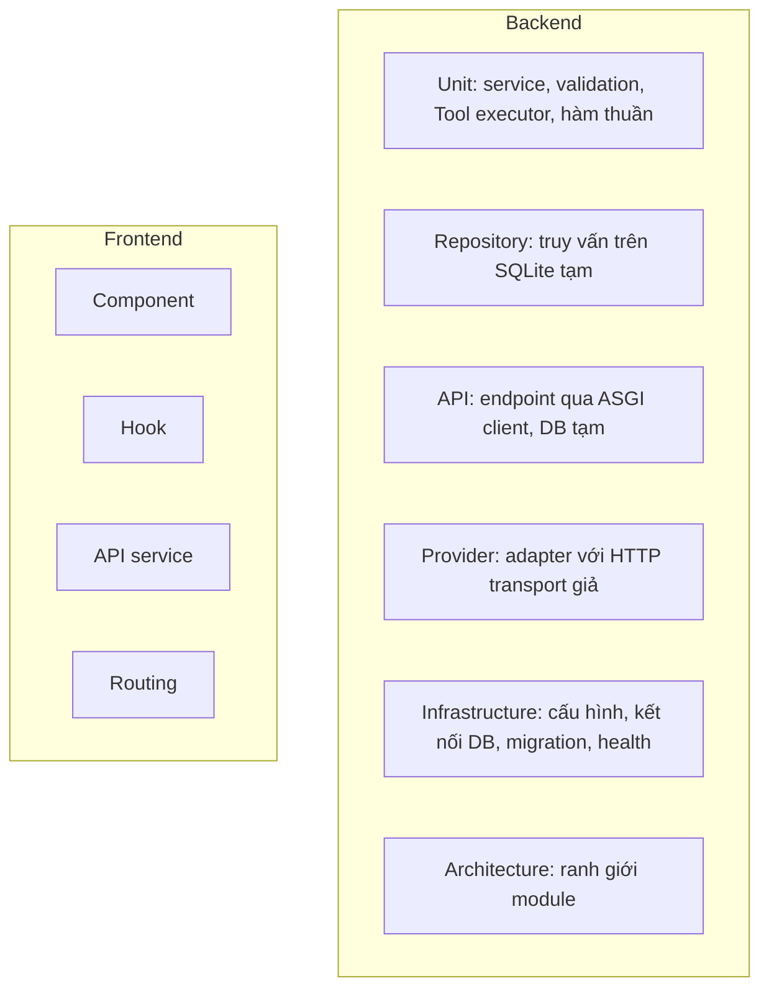
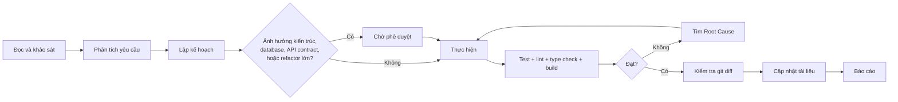

# Quy trình phát triển

> Trạng thái: **Đã phê duyệt.** Phase 2 và Phase 3 đã triển khai; phần AI (Phase 4) chưa triển khai.

## 1. Yêu cầu môi trường

| Công cụ | Phiên bản | Bắt buộc |
|---|---|---|
| Python | 3.14 | Có |
| uv | 0.11 trở lên | Có |
| Node.js | 24 | Có |
| npm | 11 | Có |
| Git | Bất kỳ bản hiện hành | Có |
| Ollama | Bản hiện hành | Không — chỉ cần khi dùng Chat với model thật |

Docker không được dùng ở giai đoạn này. Hệ thống gồm hai tiến trình cục bộ và một file SQLite; Docker chưa mang lại lợi ích.

### Lưu ý về vị trí repository

Repository hiện nằm trong thư mục được OneDrive đồng bộ. OneDrive đồng bộ cả `node_modules/`, `.venv/` và file SQLite. Điều này có thể gây khóa file, làm chậm cài đặt dependency và làm hỏng file database khi đang ghi.

Khuyến nghị: chuyển repository ra thư mục không đồng bộ (ví dụ `C:\dev\A.T.L.A.S`), hoặc loại trừ các thư mục trên khỏi OneDrive.

## 2. Cấu hình môi trường

| Môi trường | `APP_ENV` | Database | LLM Provider | Nguồn cấu hình |
|---|---|---|---|---|
| Development | `development` | `backend/data/app.db` | `ollama` | `backend/.env` |
| Testing | `testing` | SQLite tạm, tạo mới cho mỗi lần chạy | `mock` | `tests/conftest.py` |
| Production | `production` | Cấu hình tường minh | Cấu hình tường minh | Biến môi trường |

- `.env` không được commit. `.env.example` liệt kê mọi biến với giá trị mẫu không nhạy cảm.
- Test không đọc `.env` của người phát triển và không ghi vào database Development.

## 3. Lệnh thường dùng

### Backend (chạy trong `backend/`)

| Mục đích | Lệnh |
|---|---|
| Cài dependency | `uv sync` |
| Tạo file cấu hình | Sao chép `.env.example` thành `.env` |
| Áp dụng migration | `uv run alembic upgrade head` |
| Tạo migration | `uv run alembic revision --autogenerate -m "<mô tả>"` |
| Chạy server | `uv run uvicorn app.main:create_app --factory --reload` |
| Chạy test | `uv run pytest` |
| Lint | `uv run ruff check .` |
| Kiểm tra định dạng | `uv run ruff format --check .` |
| Type check | `uv run mypy app tests` |

### Frontend (chạy trong `frontend/`)

| Mục đích | Lệnh |
|---|---|
| Cài dependency | `npm install` |
| Tạo file cấu hình | Sao chép `.env.example` thành `.env` |
| Chạy dev server | `npm run dev` |
| Chạy test | `npm run test` |
| Lint | `npm run lint` |
| Type check và build | `npm run build` |

### Lỗi đã biết: Vitest báo "failed to find the current suite" trên Windows

Nguyên nhân: terminal đang đứng ở đường dẫn có ký tự ổ đĩa viết thường (`c:\...`). Vitest nạp module của chính nó hai lần dưới hai đường dẫn khác nhau.

Cách xử lý: chuyển vào thư mục bằng ký tự ổ đĩa viết hoa (`cd C:\...\frontend`) rồi chạy lại `npm run test`.

## 4. Chiến lược kiểm thử

### 4.1. Backend

| Loại test | Phạm vi | Phụ thuộc thật | Phụ thuộc giả |
|---|---|---|---|
| Unit | Một service hoặc hàm | Không | Repository, provider |
| Repository | Truy vấn SQLAlchemy | SQLite tạm | Không |
| API | Router → service → repository | SQLite tạm | LLM Provider |
| Provider | Adapter dịch vụ ngoài | Không | HTTP transport |
| Infrastructure | Cấu hình, DB, migration, health check | SQLite tạm | Không |
| Architecture | Quy tắc import giữa các module | Không | Không |

Quy tắc:

- Không test nào cần mạng hoặc Ollama.
- Mỗi test có database riêng biệt hoặc được rollback. Test không phụ thuộc thứ tự chạy.
- Repository được kiểm thử trên database thật (SQLite), không mock SQLAlchemy.
- Service test dùng repository giả khi kiểm tra quy tắc nghiệp vụ thuần; dùng SQLite tạm khi hành vi phụ thuộc truy vấn.
- Cấu trúc `tests/` phản chiếu cấu trúc `app/`.

### 4.2. Architecture test

Một test Pytest đọc cây cú pháp (AST) của mọi file trong `app/modules/` và kiểm tra:

1. Module A chỉ import module B qua `app.modules.b.public`.
2. `app.modules.ai` không import `finance`, `travel`, `food`, `dashboard`.
3. `app.core` và `app.shared` không import `app.modules`.
4. File `service.py` không import `fastapi`.

Test này không cần dependency mới. Vi phạm ranh giới được phát hiện ngay khi chạy test.

### 4.3. Frontend

Xem [frontend-architecture.md](frontend-architecture.md) mục 11.

### 4.4. AI

Xem [ai-architecture.md](ai-architecture.md) mục 12.

### 4.5. Tình huống bắt buộc

Mỗi chức năng được kiểm thử với: luồng thành công; dữ liệu không hợp lệ; dữ liệu thiếu; dữ liệu biên; dữ liệu không tồn tại; lỗi dịch vụ bên ngoài. Chức năng tiền tệ có thêm: số tiền bằng 0, số âm, giá trị lớn.

## 5. Quy trình thực hiện một thay đổi

Quy trình này là CLAUDE.md mục 17. Các hành động luôn cần phê duyệt trước: đổi stack; đổi kiến trúc tổng thể; đổi schema có ảnh hưởng lớn; xóa dữ liệu hoặc code; thêm dependency lớn; triển khai authentication; refactor diện rộng; lệnh Git phá hủy; thao tác bên ngoài có chi phí.

## 6. Tiêu chí hoàn thành

Một thay đổi được coi là hoàn thành khi:

- Code nằm đúng module và đúng tầng.
- Có test phù hợp và test đã được chạy thực tế.
- `pytest`, `ruff`, `mypy` (Backend) hoặc `test`, `lint`, `build` (Frontend) đều đạt.
- Migration đã được tạo nếu schema thay đổi.
- Kiểu dữ liệu Frontend đã được cập nhật nếu response schema thay đổi.
- Tài liệu liên quan đã được cập nhật.
- `git diff` chỉ chứa thay đổi trong phạm vi.
- Báo cáo nêu rõ phần chưa được xác minh.

## 7. Quy trình xử lý lỗi

1. Tái hiện lỗi.
2. Lấy `request_id` từ response lỗi hoặc header `X-Request-ID`. Tìm mọi dòng log có `request_id` đó.
3. Xác định module và tầng từ tên logger (ví dụ `app.modules.finance.repository`) và từ `error.code`.
4. Phân tích Root Cause.
5. Viết test tái hiện lỗi. Test phải thất bại trước khi sửa.
6. Sửa với thay đổi nhỏ nhất giải quyết đúng nguyên nhân.
7. Chạy test liên quan và test hồi quy.

Với lỗi trong luồng Chat: AI execution log cho biết intent, Tool, tham số, trạng thái và thời gian của từng bước.

## 8. Quy ước Git

- Commit theo Conventional Commits: `feat`, `fix`, `refactor`, `test`, `docs`, `chore`.
- Mỗi commit tập trung một mục tiêu.
- Kiểm tra `git status` trước và sau khi thay đổi.
- Không commit hoặc push khi chưa được yêu cầu.
- Không commit: `.env`, `.venv/`, `node_modules/`, `backend/data/`, thư mục build, cache.
- Không dùng `git reset --hard`, `git clean -fd`, `git push --force` khi chưa được yêu cầu.

## 9. Quản lý dependency

- Backend: khai báo trong `pyproject.toml`; `uv.lock` được commit. Dev dependency nằm trong nhóm riêng.
- Frontend: `package.json`; `package-lock.json` được commit.
- Trước khi thêm dependency, trả lời các câu hỏi trong CLAUDE.md mục 15. Dependency lớn cần phê duyệt.

Dependency Backend:

| Nhóm | Gói |
|---|---|
| Runtime | `fastapi`, `uvicorn`, `pydantic-settings`, `sqlalchemy[asyncio]`, `aiosqlite`, `alembic`, `httpx` |
| Dev | `pytest`, `pytest-asyncio`, `ruff`, `mypy` |

Dependency Frontend:

| Nhóm | Gói |
|---|---|
| Runtime | `react`, `react-dom`, `react-router`, `axios` |
| Dev | `vite`, `typescript`, `tailwindcss`, `@tailwindcss/vite`, `vitest`, `@testing-library/react`, `@testing-library/jest-dom`, `@testing-library/user-event`, `jsdom`, `oxlint` |

Phiên bản cụ thể được ghi trong lock file.

## 10. Lộ trình các Phase

| Phase | Nội dung | Điều kiện bắt đầu |
|---|---|---|
| 1 | Khảo sát và thiết kế kiến trúc | — |
| 2 | Cấu trúc dự án và nền tảng phát triển | Phase 1 được phê duyệt |
| 3 | Nền tảng database | Phase 2 được xác minh |
| 4 | Hạ tầng AI | Phase 3 được xác minh |
| 5 | Nền tảng kiểm thử và chất lượng | Phase 4 được xác minh |
| 6 | Tài liệu và bàn giao | Phase 5 được xác minh |

Mỗi Phase kết thúc bằng báo cáo theo mẫu bảy mục và chờ xác nhận trước khi sang Phase tiếp theo.
