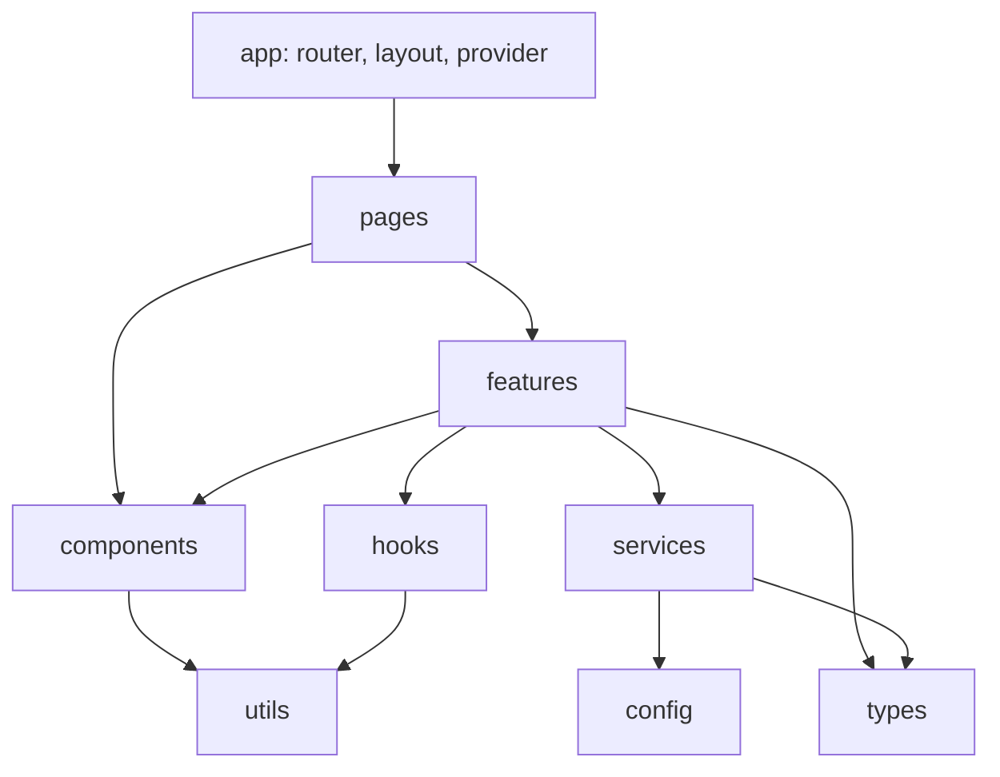
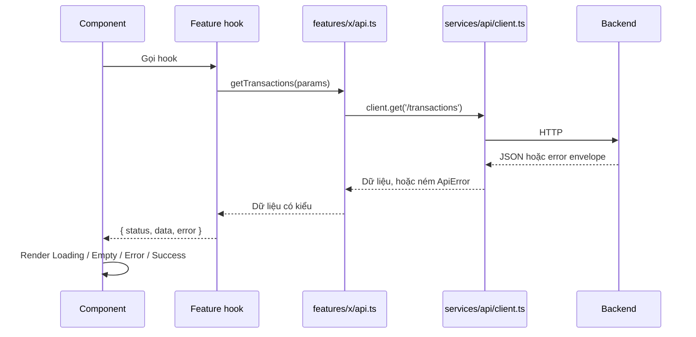

# Kiến trúc Frontend

> Trạng thái: **Đã phê duyệt và đã triển khai** (Phase 1–6). Tài liệu mô tả code hiện tại.

## 1. Công nghệ

| Thành phần | Lựa chọn | Ghi chú |
| --- | --- | --- |
| Framework | React + TypeScript (strict) | |
| Build tool | Vite | |
| CSS | Tailwind CSS | |
| Routing | React Router | |
| HTTP client | Axios | Một instance duy nhất; interceptor chuẩn hóa lỗi |
| Bản đồ | Leaflet + OpenStreetMap | Thêm khi triển khai Food/Travel, không cài ở Phase 2 |
| Test | Vitest, React Testing Library, `jsdom` | |
| Lint | oxlint (cấu hình từ template Vite hiện hành) | |

Chưa dùng ở giai đoạn nền tảng:

- **Thư viện global state** (Zustand, Redux). Chưa có state nào cần chia sẻ toàn cục.
- **Thư viện server state** (TanStack Query). Sẽ đề xuất khi tính năng dữ liệu đầu tiên xuất hiện.
- **Thư viện form**. Sẽ đánh giá khi có form nghiệp vụ đầu tiên.
- **Thư viện UI component**. Component dùng chung được viết bằng Tailwind khi có nhu cầu thực tế.

## 2. Cấu trúc thư mục

```text
frontend/
├── package.json
├── vite.config.ts            # Bao gồm cấu hình Vitest
├── tsconfig*.json
├── .oxlintrc.json
├── index.html
├── .env.example
└── src/
    ├── main.tsx              # Điểm vào: mount <App />
    ├── index.css             # Tailwind entry
    ├── app/
    │   ├── App.tsx           # Lắp ráp provider + router
    │   ├── router.tsx        # Bảng route
    │   └── layouts/          # Khung giao diện chung (AppLayout)
    ├── pages/                # Một file cho mỗi route
    ├── features/
    │   └── <feature>/
    │       ├── api.ts        # Hàm gọi endpoint của feature
    │       ├── types.ts      # Kiểu dữ liệu của feature
    │       ├── hooks/        # Logic và state của feature
    │       └── components/   # UI của feature
    ├── components/           # UI dùng chung, không chứa nghiệp vụ
    ├── hooks/                # Hook dùng chung
    ├── services/
    │   └── api/
    │       ├── client.ts     # Axios instance + interceptor
    │       └── errors.ts     # ApiError, chuẩn hóa lỗi
    ├── config/
    │   └── env.ts            # Đọc và kiểm tra import.meta.env
    ├── types/                # Kiểu dùng chung (ApiErrorBody, Page<T>)
    ├── utils/                # Hàm thuần
    └── test/
        └── setup.ts          # Cấu hình test (jest-dom, cleanup)
```

Điều chỉnh so với cấu trúc tham khảo:

- **Bổ sung `pages/` và `config/`.** `pages/` được CLAUDE.md mục 3.4 yêu cầu. `config/env.ts` là nơi duy nhất đọc biến môi trường.
- **Test đặt cạnh file nguồn** (`Button.tsx` và `Button.test.tsx`), không dùng thư mục `frontend/tests/`. Lý do: test dễ tìm, di chuyển cùng code khi refactor.
- **`stores/` chưa được tạo.** Thư mục xuất hiện khi có global state thực sự.
- Thư mục chỉ được tạo khi có file đầu tiên.

Import dùng alias `@/` trỏ tới `src/`.

## 3. Phân tầng và hướng phụ thuộc



| Thành phần | Trách nhiệm | Không được làm |
| --- | --- | --- |
| `app` | Lắp ráp ứng dụng, route, layout | Chứa logic nghiệp vụ |
| `pages` | Ghép feature thành màn hình theo route | Gọi API trực tiếp, chứa logic xử lý dữ liệu |
| `features` | Logic, state và UI của một nghiệp vụ | Import nội bộ của feature khác |
| `components` | UI tái sử dụng, điều khiển hoàn toàn qua props | Gọi API, biết về nghiệp vụ |
| `hooks` | State và logic tái sử dụng, không gắn nghiệp vụ | Render UI |
| `services` | Giao tiếp HTTP | Giữ state giao diện |
| `utils` | Hàm thuần | Side effect |

Quy tắc phụ thuộc:

- Hướng import chỉ đi xuống theo sơ đồ. `components` không import `features`. `features` không import `pages`.
- Feature A không import file nội bộ của feature B. Phần cần chia sẻ được chuyển xuống `components`, `hooks`, `types` hoặc `utils`.
- Feature Frontend tương ứng một-một với module Backend khi có thể: `chat`, `memory`, `finance`, `travel`, `food`, `dashboard`.

## 4. Luồng dữ liệu



Quy tắc:

- Component không import Axios. Component chỉ gọi hook.
- Hàm trong `features/<feature>/api.ts` là nơi duy nhất biết đường dẫn endpoint của feature đó.
- Base URL chỉ được đọc tại `config/env.ts` và dùng tại `services/api/client.ts`.
- Mỗi luồng dữ liệu biểu diễn đủ bốn trạng thái: Loading, Empty, Error, Success.

## 5. API client và xử lý lỗi

`services/api/client.ts` tạo một Axios instance:

- `baseURL` lấy từ `VITE_API_BASE_URL`.
- Timeout mặc định. Endpoint chat dùng timeout dài hơn vì LLM phản hồi chậm.
- Response interceptor chuyển mọi lỗi thành `ApiError`.

`ApiError` có các trường:

| Trường | Nguồn |
| --- | --- |
| `kind` | `validation` / `not_found` / `conflict` / `business` / `client` / `external` / `server` / `network` / `timeout` / `unknown` |
| `status` | HTTP status, `null` nếu lỗi mạng |
| `code` | `error.code` từ error envelope của Backend |
| `message` | `error.message` từ Backend, hoặc thông điệp mặc định |
| `details` | `error.details` |
| `requestId` | `error.request_id`, hiển thị được để tra log |

Ba lớp xử lý lỗi:

1. **API client** chuẩn hóa lỗi HTTP và lỗi mạng thành `ApiError`.
2. **Feature hook** đưa `ApiError` vào trạng thái `error`. Component hiển thị thông báo thân thiện và nút thử lại khi phù hợp.
3. **Error Boundary** bắt lỗi render. Một boundary bao toàn ứng dụng; một boundary bao nội dung từng route, để lỗi một màn hình không làm hỏng layout và điều hướng.

Lỗi được báo qua một hàm `reportError` duy nhất. Hàm này hiện ghi `console.error` có ngữ cảnh. Đây là điểm nối cho dịch vụ theo dõi lỗi về sau.

## 6. Routing

- Bảng route nằm tại `app/router.tsx`.
- Mọi route dùng chung `AppLayout` (điều hướng + vùng nội dung).
- Có route `*` cho trang không tồn tại.
- Phase 2 chỉ tạo một trang chủ hiển thị trạng thái Backend qua health check, và trang 404. Route của các feature được thêm khi feature được triển khai.

Route dự kiến:

| Route | Trang |
| --- | --- |
| `/` | Dashboard |
| `/chat` | Chat |
| `/finance` | Finance |
| `/travel` | Travel |
| `/food` | Food Discovery |
| `/memory` | Personal Memory |

## 7. Quản lý state

| Loại state | Ví dụ | Vị trí |
| --- | --- | --- |
| Server state | Danh sách giao dịch, hội thoại | Feature hook; không sao chép vào global store |
| UI state cục bộ | Modal đang mở, giá trị ô nhập | `useState` trong component |
| State theo URL | Bộ lọc, trang hiện tại | Search params của React Router |
| Global client state | Chưa có | `stores/`, chỉ khi cần |

Không lưu dữ liệu nhạy cảm vào Local Storage.

## 8. Kiểu dữ liệu

- `tsconfig` bật `strict`. Không dùng `any`; dữ liệu chưa biết kiểu dùng `unknown` và thu hẹp kiểu.
- Kiểu dữ liệu trao đổi với Backend nằm trong `features/<feature>/types.ts`, viết tay theo response schema.
- Kiểu dùng chung nằm trong `types/`: `ApiErrorBody`, `Page<T>`.
- Khi Backend đổi response schema, kiểu Frontend tương ứng phải được cập nhật trong cùng thay đổi.

Việc sinh kiểu tự động từ OpenAPI sẽ được đánh giá khi số lượng endpoint tăng.

## 9. Giao diện

- Tailwind utility class. Không dùng CSS inline, trừ giá trị tính toán động.
- Thiết kế mobile-first, dùng breakpoint của Tailwind.
- Semantic HTML (`main`, `nav`, `button`, `label`). Phần tử tương tác dùng được bằng bàn phím.
- Danh sách dùng ID ổn định làm `key`.

## 10. Biến môi trường

| Biến | Ý nghĩa | Mẫu |
| --- | --- | --- |
| `VITE_API_BASE_URL` | Địa chỉ gốc của API | `http://127.0.0.1:8710/api/v1` |
| `VITE_DEV_SERVER_PORT` | Cổng của dev server | `5710` |

`config/env.ts` kiểm tra biến bắt buộc khi khởi động và báo lỗi rõ ràng nếu thiếu. Biến `VITE_*` được nhúng vào bundle, nên không đặt secret ở Frontend.

## 11. Kiểm thử

| Loại | Đối tượng | Công cụ |
| --- | --- | --- |
| Component | Render, tương tác, bốn trạng thái dữ liệu | React Testing Library |
| Hook | Chuyển trạng thái, xử lý lỗi | `renderHook` |
| API service | Chuẩn hóa lỗi thành `ApiError`, ánh xạ dữ liệu | Vitest, mock adapter của Axios |
| Routing | Trang đúng theo route, trang 404 | React Testing Library + router trong bộ nhớ |

Test không gọi Backend thật.
