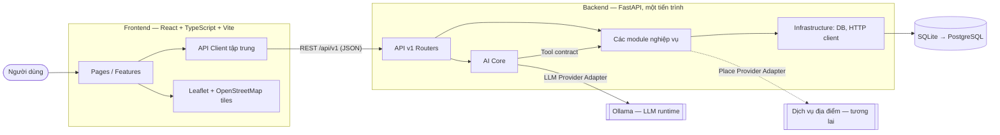
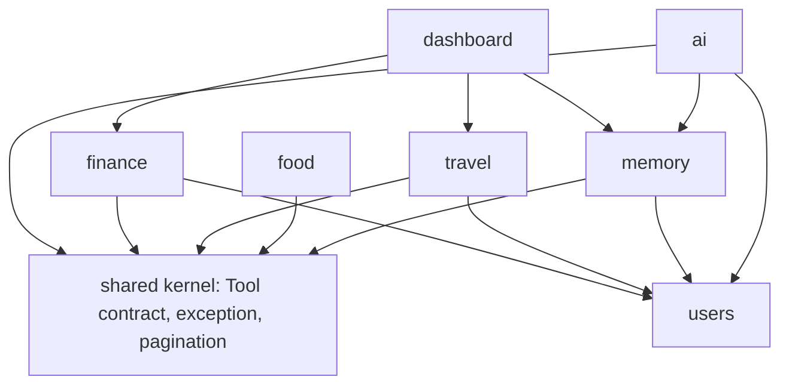
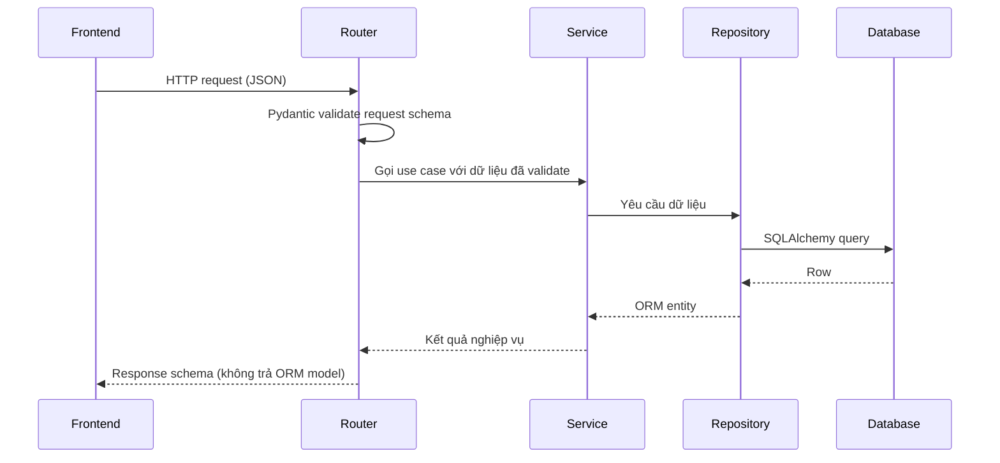

# Tổng quan hệ thống

> Trạng thái: **Đã phê duyệt.** Phase 2 và Phase 3 đã triển khai; phần AI (Phase 4) chưa triển khai.

## 1. Mục đích

AI Personal Assistant là ứng dụng trợ lý cá nhân chạy cục bộ, kết hợp giao diện Chat và Dashboard. Người dùng trò chuyện bằng ngôn ngữ tự nhiên; AI hiểu yêu cầu và điều phối các Tool; Backend thực thi nghiệp vụ và quản lý dữ liệu.

Tài liệu này là điểm vào của bộ tài liệu kiến trúc:

| Tài liệu | Nội dung |
|---|---|
| [backend-architecture.md](backend-architecture.md) | Phân tầng, module, lỗi, logging, cấu hình Backend |
| [frontend-architecture.md](frontend-architecture.md) | Cấu trúc và quy ước Frontend |
| [ai-architecture.md](ai-architecture.md) | Orchestrator, Tool, LLM Provider |
| [database-architecture.md](database-architecture.md) | Quy ước dữ liệu, ERD, migration |
| [development-workflow.md](development-workflow.md) | Môi trường, lệnh, kiểm thử, quy trình |

## 2. Hiện trạng repository (khảo sát ngày 2026-11-14)

- Repository chỉ có `CLAUDE.md`. Chưa có commit, chưa có source code.
- Remote `origin` đã cấu hình, nhánh `main` chưa tồn tại trên remote.
- Môi trường máy phát triển: Python 3.14.3, Node 24.14.1, npm 11.11.0, uv 0.11.19.
- Ollama **chưa được cài đặt** trên máy. Kiến trúc phải cho phép Backend khởi động và chạy test khi không có Ollama.

Kết luận: đây là dự án khởi tạo mới, không có code cần kế thừa.

## 3. Kiến trúc tổng thể

Hệ thống là một **Modular Monolith**: một tiến trình Backend, một ứng dụng Frontend, một database.



Nguyên tắc cốt lõi:

1. **Frontend chỉ nói chuyện với Backend qua REST `/api/v1`.** Frontend không gọi Ollama hay dịch vụ địa điểm trực tiếp. Ngoại lệ duy nhất: Leaflet tải ảnh bản đồ (tiles) từ OpenStreetMap.
2. **LLM không chạm vào database và không thực thi nghiệp vụ.** LLM chỉ đề xuất Tool và tham số. Backend validate rồi mới thực thi.
3. **Mọi dịch vụ bên ngoài đi qua Adapter.** Có thể thay thế hoặc mock mà không sửa nghiệp vụ.
4. **Module có ranh giới tường minh.** Module chỉ dùng public interface của module khác.

## 4. Các module và quan hệ phụ thuộc

| Module | Trách nhiệm | Sở hữu dữ liệu |
|---|---|---|
| `users` | Danh tính người dùng hiện tại | `users` |
| `ai` | Orchestrator, Intent, Tool Registry, Tool Execution, LLM Provider | Không có bảng riêng |
| `memory` | Conversation Memory, Long-term Memory, Memory Retrieval | `conversations`, `messages`, `memories` |
| `finance` | Giao dịch, danh mục, ngân sách, báo cáo | `transactions`, `transaction_categories`, `budgets` |
| `travel` | Kế hoạch du lịch, lịch trình | `travel_plans`, `itinerary_items` |
| `food` | Tìm kiếm và đề xuất địa điểm ăn uống | Chưa xác định |
| `dashboard` | Tổng hợp dữ liệu để hiển thị | Không có bảng riêng |

`users` là module bổ sung so với danh sách trong CLAUDE.md mục 3.2. Lý do: mọi dữ liệu đều thuộc về một người dùng, và không module nghiệp vụ nào là chủ sở hữu hợp lý của bảng `users`. Xem ADR-0007.



Quy tắc phụ thuộc:

- Mũi tên chỉ hướng "được phép import". Không có mũi tên ngược. Không có vòng lặp.
- Import giữa các module chỉ được trỏ vào file `public.py` của module đích.
- `ai` **không** import `finance`, `travel`, `food`. Các module này tự định nghĩa Tool theo Tool contract trong `shared`. Composition root (`app/bootstrap.py`) đăng ký Tool vào Tool Registry.
- `dashboard` chỉ đọc dữ liệu qua public service của module khác. `dashboard` không chứa phép tính nghiệp vụ.
- Ranh giới được kiểm tra tự động bằng một architecture test (xem [development-workflow.md](development-workflow.md)).

## 5. Luồng xử lý tiêu biểu

### 5.1. Luồng CRUD thông thường



### 5.2. Luồng Chat

Chi tiết trong [ai-architecture.md](ai-architecture.md). Tóm tắt: Router `chat` gọi Orchestrator; Orchestrator nạp ngữ cảnh, phân loại ý định, để LLM chọn Tool, validate tham số, thực thi Tool qua service của module nghiệp vụ, validate kết quả, yêu cầu LLM tổng hợp câu trả lời, lưu hội thoại.

## 6. Cấu trúc thư mục cấp cao

```text
A.T.L.A.S/
├── CLAUDE.md
├── README.md
├── .gitignore
├── backend/            # FastAPI app, test, migration — xem backend-architecture.md
├── frontend/           # React app — xem frontend-architecture.md
└── docs/
    ├── architecture/   # Bộ tài liệu này
    ├── decisions/ADR/  # Architecture Decision Records
    ├── database/       # Tài liệu schema (Phase 3)
    ├── api/            # Tài liệu API (Phase 6)
    ├── testing/        # Hướng dẫn kiểm thử (Phase 5)
    └── debugging/      # Hướng dẫn debug (Phase 6)
```

Điều chỉnh so với cấu trúc tham khảo trong yêu cầu:

- **Không có `.env.example` ở thư mục gốc.** Mỗi ứng dụng có file riêng: `backend/.env.example` và `frontend/.env.example`. Lý do: Vite và Backend đọc biến môi trường từ thư mục của chính nó; một file chung sẽ khiến hai ứng dụng nhìn thấy cấu hình của nhau.
- **Không tạo `scripts/` lúc này.** Chưa có script nào cần thiết. Thư mục được tạo khi có script đầu tiên.
- **Thư mục `docs/modules/`** được tạo khi module nghiệp vụ đầu tiên được triển khai.

## 7. Thuộc tính chất lượng và cách đáp ứng

| Thuộc tính | Cơ chế |
|---|---|
| Maintainability | Module theo nghiệp vụ; tầng rõ ràng; quy ước đặt tên thống nhất; lint + type check |
| Debuggability | Log có cấu trúc kèm `request_id`; phân cấp exception theo loại lỗi; error envelope thống nhất; log riêng cho từng lượt AI |
| Extensibility | Thêm module = thêm thư mục + đăng ký router/Tool tại composition root; Provider Adapter cho LLM và dịch vụ ngoài |
| Testability | Constructor injection; `MockLLMProvider`; SQLite tạm cho test; không cần Ollama hay mạng |
| Simplicity | Không DI container, không message bus, không framework AI, không Docker, không vector database |

## 8. Các quyết định cần ghi nhận bằng ADR

Các ADR nằm trong [docs/decisions/ADR/](../decisions/ADR/).

| ADR | Quyết định đề xuất | Lý do chính |
|---|---|---|
| 0001 | Modular Monolith, module theo nghiệp vụ, ranh giới qua `public.py` | Yêu cầu của CLAUDE.md; đủ cho một người dùng; tách được về sau |
| 0002 | SQLAlchemy 2.0 **async** (`aiosqlite`, sau này `asyncpg`) | Luồng Chat là I/O dài (gọi LLM); session đồng bộ sẽ chặn event loop |
| 0003 | Khóa chính UUID sinh ở tầng ứng dụng | ID xuất hiện trong URL, log và tham số Tool; không đoán được; dễ chuyển sang PostgreSQL |
| 0004 | Tiền lưu bằng số nguyên `BIGINT` đơn vị VND | VND không có đơn vị lẻ; tuyệt đối không dùng `float` |
| 0005 | LLM Provider Adapter + Tool calling tự xây, không dùng framework AI | Luồng đơn giản, kiểm soát được validation và log; tránh dependency lớn |
| 0006 | Tool contract nằm trong shared kernel, đăng ký tại composition root | AI Core không phụ thuộc module nghiệp vụ; không tạo vòng phụ thuộc |
| 0007 | Module `users` + một người dùng cục bộ mặc định, **chưa có authentication** | MVP một người dùng; giữ sẵn `user_id` và điểm nối `get_current_user` |
| 0008 | Logging bằng thư viện chuẩn `logging` + JSON formatter tự viết | Không cần thêm dependency; đủ ngữ cảnh `request_id` qua `contextvars` |
| 0009 | Error envelope thống nhất và phân cấp `AppError` | CLAUDE.md mục 9 và 10.2 |
| 0010 | `uv` quản lý môi trường và dependency Python | Đã cài sẵn; lock file tái lập được; một công cụ cho venv và dependency |

## 9. Các điểm đã được người dùng quyết định

Các phương án khuyến nghị dưới đây đã được chấp thuận ngày 2026-11-14.

1. **Async SQLAlchemy (ADR-0002).** Khuyến nghị: async. Hệ quả: thêm dependency `aiosqlite`.
2. **Authentication (ADR-0007).** Khuyến nghị: chưa triển khai; Backend chỉ lắng nghe `127.0.0.1`. Mọi bảng dữ liệu vẫn có `user_id`.
3. **Phạm vi bảng tạo ở Phase 3.** Khuyến nghị: migration đầu tiên chỉ tạo `users`, `conversations`, `messages`, `memories` — các bảng mà hạ tầng AI ở Phase 4 thực sự cần. Bảng Finance và Travel được thiết kế ở mức ERD và tạo khi triển khai module tương ứng. Phương án thay thế: tạo cả 9 bảng với cột tối thiểu.
4. **Bước Intent Classification riêng.** Khuyến nghị: giữ bước riêng theo CLAUDE.md mục 6.1. Hệ quả: hai lần gọi LLM mỗi lượt chat khi cần Tool. Xem [ai-architecture.md](ai-architecture.md) mục 5.
5. **Dev dependency cho chất lượng code.** Khuyến nghị: Ruff + mypy (Backend), ESLint (Frontend, có sẵn trong template Vite).
6. **Thư viện server state cho Frontend.** Khuyến nghị: chưa thêm ở Phase 2. Đề xuất TanStack Query khi tính năng dữ liệu đầu tiên xuất hiện; sẽ xin phê duyệt lúc đó.

## 10. Ngoài phạm vi giai đoạn nền tảng

- Nghiệp vụ của Finance, Travel, Food, Dashboard.
- Authentication và phân quyền.
- Streaming câu trả lời (SSE/WebSocket).
- Vector database và tìm kiếm ngữ nghĩa.
- Multi-Agent.
- Docker và triển khai Production.
